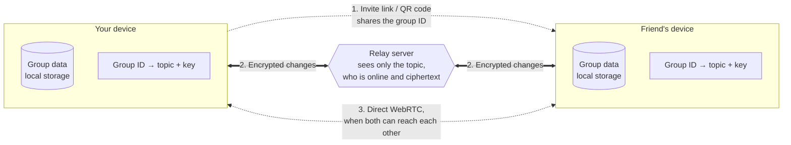

# PeerPocket

Your (PWA) Peer-to-peer expense tracker

> **PeerPocket are under an early development**, we might ship a new version which is not compatible with your existing data. Please understand that you might lose your data anytime.

## How does it work?

PeerPocket never store your data outside your devices, instead **the same expense group data on all online devices will be synced** via our tiny WebSocket relay server. Technically, subscribing to the same WebSocket topic derived from a random generated group ID. Everything passing through the relay is end-to-end encrypted with a key derived from the same ID, which never leaves your devices, so the relay can't read or tamper with your data. It still sees who is online, message sizes and timing, and IP addresses.

1. Joining a group means receiving its ID from a member, through an invite link or QR code. Each device derives a relay topic and an encryption key from that ID.
2. Online devices subscribe to the same topic and exchange encrypted changes through the relay, which only forwards them.
3. Devices also use the relay to set up a direct WebRTC connection and sync over it when the network allows.

Changes made offline are kept on the device and merged automatically ([TinyBase](https://tinybase.org/) mergeable store) the next time members are online together.

## Tech Stack

- [Bun](https://bun.sh/)
- WebSocket and [MessagePack](https://msgpack.org/)
- [React](https://react.dev/) on [Rspack](https://rspack.rs)
- TanStack [Router](https://tanstack.com/router/) and [Form](https://tanstack.com/form/)
- [Tinybase](https://tinybase.org/)
- [MUI](https://mui.com/) and [Tailwind CSS](https://tailwindcss.com)
